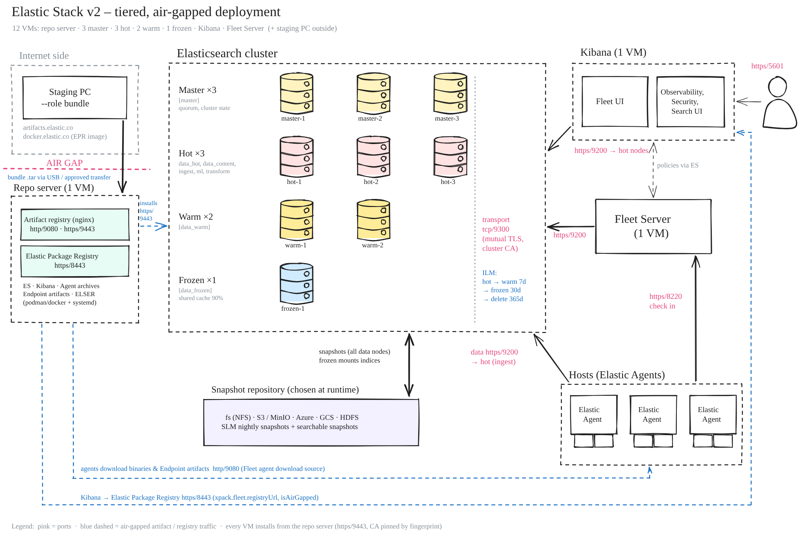

# elastic-node-setup-v2.sh – Tiered, Air-Gapped Elastic Stack 9.x

One script, run on each VM, that installs a secured, self-managed **Elastic Stack 9.x** from the official **tar.gz archives** (no RPM/DEB), with dedicated master, hot, warm and frozen tiers and an air-gapped repository server.

| Component | VMs | Node roles |
|---|---|---|
| Repository server | 1 | Artifact registry (nginx) + Elastic Package Registry, in containers |
| Elasticsearch – master | 3 | `master` |
| Elasticsearch – hot | 3 | `data_hot, data_content, ingest, ml, transform, remote_cluster_client` |
| Elasticsearch – warm | 2 | `data_warm` |
| Elasticsearch – frozen | 1 | `data_frozen` (searchable snapshots on an external repository) |
| Kibana | 1 | – |
| Fleet Server | 1 | Elastic Agent (servers flavor) |

A staging PC **with** Internet access builds the air-gap bundle; it is not part of the cluster.


Editable diagram: `images/elastic-v2-architecture.excalidraw` (open at excalidraw.com or in the VS Code Excalidraw extension).

---

## 1. What changed from v1

| Area | v1 | v2 |
|---|---|---|
| Topology | 3 hot nodes (master-eligible) | 3 dedicated masters, 3 hot, 2 warm, 1 frozen |
| Joining nodes | Enrollment tokens (30 min) | Encrypted **node packs** generated once on master-1 |
| TLS | Elastic auto-configuration | Own cluster CA, one certificate per node (SANs = name + IP), `verification_mode: full` |
| Packages | Internet or files next to the script | **Repository server** (air-gapped), Internet, or local files |
| Fleet | Public package registry | Local Elastic Package Registry, `xpack.fleet.isAirGapped`, local agent download source |
| Data lifecycle | – | Snapshot repository, ILM hot → warm → frozen → delete, SLM nightly snapshots |

---

## 2. Roles and run order

Run every role as root: `sudo ./elastic-node-setup-v2.sh --role <role> [...]`. Without `--role` a menu is shown.

| # | VM | Role | What it does |
|---|---|---|---|
| 0 | Staging PC (Internet) | `bundle` | Downloads ES, Kibana, Agent (+ `.sha512`), optional agent packages for Windows/macOS/DEB/RPM, Endpoint artifacts, ELSER, `repository-hdfs`, GPG keys and the EPR + nginx images. Writes `SHA256SUMS` and one `.tar`. |
| 1 | Repository server | `repo` | Verifies the bundle, publishes it with nginx (HTTP **9080** for agents, HTTPS **9443** for the installer) and runs the **Elastic Package Registry** on HTTPS **8443**. Prints the **repository CA fingerprint**. |
| 2 | master-1 | `es-first` | Asks for the cluster plan (names + IPs of all VMs), cluster settings, package source and snapshot repository. Creates the cluster CA, a certificate and an **encrypted pack** for every other VM, then installs master-1. |
| 3 | master-2, master-3 | `es-node --pack <name>.pack` | Installs the other masters; the cluster forms when the second master starts. |
| 4 | hot-1..3 | `es-node --pack <name>.pack` | Installs the hot nodes. The first hot node stores the `elastic` password in the security index. |
| 5 | warm-1..2 | `es-node --pack <name>.pack` | Installs the warm nodes (checks that a hot node is up first). |
| 6 | frozen-1 | `es-node --pack <name>.pack` | Installs the frozen node; asks for the shared-cache size (default 90 %). |
| 7 | master-1 | `es-finalize` | Verifies topology and roles, registers + verifies the snapshot repository, licence, ILM policy, `logs@custom` / `metrics@custom`, SLM. |
| 8 | Kibana VM | `kibana --pack <name>.pack` | HTTPS Kibana, service-account token, air-gapped Fleet settings, Fleet output / Fleet Server host / download source / policies. |
| 9 | Fleet Server VM | `fleet --pack <name>.pack` | Elastic Agent as Fleet Server on 8220 with a cluster-CA certificate. |
| 10 | ES and Kibana VMs | `monitor` | *Optional:* Elastic Agent for Stack Monitoring (token from the Kibana summary). |
| – | master-1 | `pack` | Re-issues a pack (lost pack, replaced VM). |

Every run writes a log to `/var/log/elastic-node-setup-<role>-<time>.log` and a summary to `/root/elastic-<role>-summary.txt`.

---

## 3. Execution (example IPs)

| VM | IP | VM | IP |
|---|---|---|---|
| repo-1 | 10.20.0.5 | warm-1, warm-2 | 10.20.0.31–32 |
| es-master-1..3 | 10.20.0.11–13 | es-frozen-1 | 10.20.0.41 |
| es-hot-1..3 | 10.20.0.21–23 | kibana-1 / fleet-server-1 | 10.20.0.51 / .52 |

**Step 0 – staging PC with Internet (podman or docker installed)**
```bash
sudo ./elastic-node-setup-v2.sh --role bundle
# -> /root/elastic-airgap-bundle-9.5.5.tar  (copy it to the repository server)
```

**Step 1 – repository server** (podman or docker from the internal OS mirror)
```bash
sudo ./elastic-node-setup-v2.sh --role repo
# note the "Repository CA fingerprint"
```

**Step 2 – master-1**
```bash
sudo ./elastic-node-setup-v2.sh --role es-first                 # interactive plan
sudo ./elastic-node-setup-v2.sh --role es-first --plan plan.txt # or from a file
```
`plan.txt` – one VM per line, `type name ip`:
```
master es-master-1 10.20.0.11
master es-master-2 10.20.0.12
master es-master-3 10.20.0.13
hot    es-hot-1    10.20.0.21
hot    es-hot-2    10.20.0.22
hot    es-hot-3    10.20.0.23
warm   es-warm-1   10.20.0.31
warm   es-warm-2   10.20.0.32
frozen es-frozen-1 10.20.0.41
kibana kibana-1    10.20.0.51
fleet  fleet-server-1 10.20.0.52
```
Choose package source `repo`, enter the repository server address and its CA fingerprint, then the snapshot repository. The packs are written to `/root/elastic-cluster/packs/`.

**Steps 3–6 – copy each pack to its VM and run, in this order**
```bash
scp /root/elastic-cluster/packs/es-master-2.pack admin@10.20.0.12:   # from master-1
sudo ./elastic-node-setup-v2.sh --role es-node --pack es-master-2.pack   # on es-master-2
# then es-master-3 → es-hot-1..3 → es-warm-1..2 → es-frozen-1 (same command, own pack)
```

**Step 7 – master-1**
```bash
sudo ./elastic-node-setup-v2.sh --role es-finalize
```

**Steps 8–9 – Kibana, then Fleet Server**
```bash
sudo ./elastic-node-setup-v2.sh --role kibana --pack kibana-1.pack        # on kibana-1
sudo ./elastic-node-setup-v2.sh --role fleet  --pack fleet-server-1.pack  # on fleet-server-1
```

**Step 10 – optional Stack Monitoring** (each ES VM and the Kibana VM)
```bash
sudo ./elastic-node-setup-v2.sh --role monitor --token-file es-monitoring.token
```

---

## 4. Snapshot repository (chosen at runtime)

Asked in `es-first`; credentials go into each node's keystore through its pack. A repository is **required** when a frozen node is planned. Supported self-managed types ([Elastic docs](https://www.elastic.co/docs/deploy-manage/tools/snapshot-and-restore/self-managed#self-managed-repo-types)):

| Type | What the script asks / does |
|---|---|
| `fs` | Mount point (`path.repo`, default `/mnt/es-snapshots`). Either mounts an NFS export (`server:/path`, `/etc/fstab` entry) or uses an existing mount. Same UID/GID for `elasticsearch` on every node (default 1550). |
| `s3` | Bucket, base path, optional endpoint (MinIO, Ceph RGW, StorageGRID …), path-style access, optional endpoint CA (imported into the bundled JDK), access/secret key. |
| `azure` | Storage account, account key **or** SAS token, container, base path, optional endpoint suffix. |
| `gcs` | Bucket, base path, service-account JSON file, optional endpoint. |
| `hdfs` | NameNode URI and path; installs `repository-hdfs` from the repository server. |

`es-finalize` registers the repository and runs `_verify` against every node.

---

## 5. What is covered

**Installation and OS**
- Binary installs under `/opt/elastic`, systemd services, `debian` / `rhel` / `suse`, x86_64 and aarch64; default version **9.5.5**.
- SHA-512 verification of every archive, GPG signature check when `gpg` and the `.asc` are available.
- `vm.max_map_count`, `vm.swappiness=1`, `tcp_retries2=5`, swap off, memory lock, file/thread limits, time sync.
- Custom data directory per node (created, `elasticsearch:elasticsearch`, `750`, SELinux label if enabled).
- Managed `/etc/hosts` block for all planned VMs; firewalld/ufw rules (9300 only between ES nodes).

**Elasticsearch**
- Dedicated tiers with explicit `node.roles` (no generic `data` role); `discovery.seed_hosts` = masters; `cluster.initial_master_nodes` only for bootstrap and removed afterwards.
- Heap 50 % of RAM (capped for compressed oops, rounded to 512 MB); compressed oops checked after start.
- Roles of every node verified against the plan in `es-finalize`.

**Security**
- Own cluster CA; per-node certificates for HTTP and transport, `verification_mode: full`.
- Packs: `tar.gz` encrypted with AES-256-CBC, PBKDF2 (600 000 iterations); passphrase read without echo.
- `elastic` password via `bootstrap.password` in the keystore, then stored in the security index.
- Kibana uses a service-account token; Fleet Server uses its own service token; secrets never on command lines.
- Fleet output pins the cluster CA fingerprint; repository CA trusted only after its fingerprint matches.

**Air-gapped**
- One bundle, one repository server: artifact registry (HTTP for agents as Elastic recommends, HTTPS for the installer), EPR, Endpoint artifacts, ELSER files.
- Kibana: `xpack.fleet.isAirGapped`, `xpack.fleet.registryUrl`, `NODE_EXTRA_CA_CERTS`, telemetry/newsfeed/EMS off.
- Fleet agent binary download source points at the repository server.

**Data lifecycle**
- Licence: install a file, start the 30-day trial, or skip (frozen phase omitted).
- ILM `hot-warm-frozen`: rollover 50 GB / 30 d → warm 7 d → frozen 30 d (searchable snapshot) → delete 365 d (all adjustable).
- Applied to Fleet data through `logs@custom` and `metrics@custom`; SLM nightly snapshot at 01:30, 30 days retention.

**Kibana / Fleet**
- Kibana heap configurable; Fleet output = hot nodes; Fleet Server host; Fleet Server policy; Stack Monitoring policies (optional).

---

## 6. What is not covered

- OS mirrors: podman/docker, `chrony`, `nfs-utils`, `unzip` come from your internal OS repository.
- Load balancer / DNS for Kibana, Fleet Server or Elasticsearch.
- Cold tier, cross-cluster search/replication, dedicated ML or coordinating nodes.
- Upgrades, rolling restarts, scaling after install (use `--role pack` to issue packs for replacements).
- Alerting connectors, LDAP/SAML/OIDC, role design beyond `elastic`.
- Elastic Defend policy settings (point `*.advanced.artifacts.global.base_url` at `http://<repo>:9080` yourself).
- Backups of `/root/elastic-cluster` (CA key and packs) – keep an offline copy.

---

## 7. Licence note

Searchable snapshots, which the **frozen tier** depends on, require an **Enterprise** licence. Without it, `es-finalize` leaves the frozen phase out of ILM; the frozen node joins but holds no data.

---

## 8. Ports

| Port | From → To | Purpose |
|---|---|---|
| 9200/tcp | Kibana, Fleet Server, agents, admins → ES | HTTPS REST (agents write to hot nodes) |
| 9300/tcp | ES ↔ ES | Transport, mutual TLS |
| 5601/tcp | Users → Kibana | HTTPS |
| 8220/tcp | Agents → Fleet Server | HTTPS |
| 9080/tcp | Agents → repo server | Agent binaries, Endpoint artifacts, ELSER |
| 9443/tcp | All VMs (installer) → repo server | Archives, verified TLS |
| 8443/tcp | Kibana → repo server | Elastic Package Registry |

---

## 9. Test run

No real VMs or Internet downloads were available for this test (Elastic's download hosts and Docker Hub were blocked). The script was run **unchanged, end to end, on 13 simulated VMs** (12 cluster VMs + the staging PC). Each VM was a Linux network namespace with its own IP on one bridge and its own `/etc`, `/opt`, `/var`, `/root`, `/srv`.

- **Real components:** bash, openssl (CA, certificates, encrypted packs), curl with full TLS verification, `tar`/`sha256sum`/`sha512sum`, and a real nginx serving the repository on 9080/9443.
- **Simulated components:** Elasticsearch, Kibana, Elastic Agent/Fleet Server and the EPR. The simulators enforce the integration points the script depends on:
  - bootstrap checks (heap, file descriptors, `max_map_count`)
  - certificate/key/CA/SAN validation and mutual-TLS transport with master quorum
  - tier roles, `path.repo`/UID checks and repository `_verify`
  - the licence gate for searchable snapshots
  - service tokens, Fleet output/fingerprint checks, the download source over HTTP, EPR reachability through `NODE_EXTRA_CA_CERTS`, and enrolment keys

| Step | VM(s) | Result |
|---|---|---|
| bundle | staging PC | ✔ archives + checksums, agent packages (missing optional package skipped), Endpoint, ELSER, HDFS plugin, images, `SHA256SUMS`, `.tar` |
| repo | repo-1 | ✔ bundle verified, nginx 9080/9443 and EPR 8443 healthy, CA fingerprint printed |
| es-first | master-1 | ✔ plan, CA, 10 encrypted packs, master-1 installed |
| es-node | master-2, master-3 | ✔ cluster formed (quorum), `initial_master_nodes` removed |
| es-node | hot-1..3 | ✔ joined; password stored in the security index |
| es-node | warm-1..2, frozen-1 | ✔ joined with `w` / `f` roles |
| es-finalize | master-1 | ✔ 9/9 nodes with expected roles, fs repository verified on 9 nodes, trial, ILM, `@custom` templates, SLM |
| kibana | kibana-1 | ✔ HTTPS, service token, air-gapped Fleet, output, Fleet Server host, download source, policies |
| fleet | fleet-server-1 | ✔ Fleet Server HEALTHY on 8220 |
| monitor | 9 ES VMs + Kibana | ✔ 10 agents enrolled |

**Final state checks (from master-1):**
- `_cat/nodes` shows `m m m hilrst hilrst hilrst w w f`, and cluster health is green with 9 nodes.
- The `elastic-snapshots` (fs) repository is registered.
- The `hot-warm-frozen` ILM policy has a `searchable_snapshot` frozen phase.
- The `nightly-snapshots` SLM policy exists.
- Kibana reports `available`, and Fleet Server reports `HEALTHY`.
- 11 agents are online.
- The EPR returns 200, and the agent binary is served over http/9080.

**Bugs found and fixed during the run:**
- A strict JSON `grep` aborted the run on an unformed cluster under `set -e`.
- The keystore message wrongly mentioned credentials for `fs`.
- Cosmetic output issues.
- The default heap is now rounded to 512 MB.

The final script passes `bash -n` and ShellCheck (`-S warning`).

---

## 10. Needs confirmation on real VMs

The simulated run cannot prove these Elasticsearch/Kibana behaviours; confirm them in a pilot before production:

1. `bootstrap.password` authenticates on the dedicated masters before the security index exists, and the first hot node can then persist the password.
2. Real `elasticsearch.yml` / `kibana.yml` parsing of every generated setting for your exact 9.x version.
3. The EPR container user can read the TLS key mounted from `/srv/elastic-repo/certs/serve` (mode 0644).
4. Snapshot repositories other than `fs`, and ILM moving real indices to the frozen tier.
5. Package availability on your internal OS mirror (podman/docker, chrony, nfs-utils, unzip).
