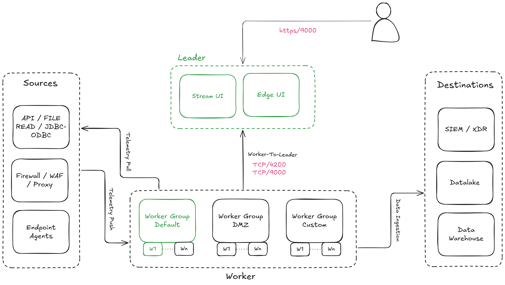

# Cribl Stream 4.x – Distributed Leader/Worker Setup

`cribl-deploy.sh` installs Cribl Stream in distributed mode from the official **tar.gz (bundle) archive** — no RPM/DEB packages. You copy the one script to every VM and run it there, choosing that VM's **role**.

The result is a distributed deployment of two VMs:

- 1 × Leader
- 1 × Worker

More Workers are added by running the same script on each new VM.

It follows Cribl's guide [*Set Up Leader and Worker Nodes*](https://docs.cribl.io/stream/setting-up-leader-and-worker-nodes/), adapted to bundle installs and hardened with Cribl's [*OS Tuning*](https://docs.cribl.io/stream/os-tuning/) guidance.

---

## Architecture



> [Editable Architecture File](images/Cribl_Worker_Leader.excalidraw) (open it at <https://excalidraw.com> → *Open*).

| Component | Port | Who connects |
|---|---|---|
| Leader UI / API | 9000/tcp | Users' browsers, admins |
| Leader distributed management | 4200/tcp | Workers (Worker → Leader) |
| Worker data inputs | As configured (e.g. 514/udp, 9514/tcp) | Data sources |

---

## What the script does

**Security**
- Cribl runs as a dedicated non-root `cribl` user with no login shell.
- Leader and Worker authenticate with a shared **auth token**. The Leader generates a random token; the well-known default `criblmaster` is refused.
- Optional TLS between Leader and Worker with your own certificate and key.
- Privileged ports (below 1024, e.g. syslog 514) are allowed without running as root.

**Distributed setup**
- The Leader is configured with `cribl mode-master`.
- Each Worker is configured with `cribl mode-worker` and joins a **Worker Group** (default: `default`), with optional tags.
- After the Leader install, the script prints the exact command to run on each Worker.

**Operating system tuning**
- Open-file and process limits are raised (65536 / 16384).
- Kernel network settings are tuned (`somaxconn`, backlog, TCP keepalive, port range).
- Transparent Huge Pages are disabled.
- Workers get 25 MB socket receive buffers and a larger connection-tracking table for high-rate ingest.
- Time sync is enabled (existing `systemd-timesyncd`/`ntpd`, or chrony).
- A systemd service is created with automatic restart.

**Prerequisites**
- OS packages and the Cribl bundle are checked before anything on the host changes.
- If anything must be downloaded, the script asks once whether the host has internet access. Answering `n` stops the script with an exact list of what is required.

**Reinstalls**
- Previous or partial installs (install directory, service files, running processes, leftover RPM/DEB) are detected and stopped.
- The old install is **backed up** by default, or deleted on request.

**Firewall**
- Only the required ports are opened in firewalld or ufw.
- Leader: 9000 and 4200. Worker: only the data ports you specify.

**Platform**
- SELinux labels are set on RHEL-family hosts where enforcing.

**Downloads**
- The bundle is validated before installation.
- Air-gapped use is supported: place the bundle next to the script.

---

## Requirements

**VMs (minimal sizing)**

| VM | Role | Suggested sizing |
|---|---|---|
| VM 1 | `leader` | 4+ vCPU, 8+ GB RAM, 5+ GB free on `/opt` |
| VM 2 | `worker` | 4+ vCPU, 8+ GB RAM, 5+ GB free on `/opt` |

Smaller VMs only produce a warning, so lab hosts work.

**Software and access**
- **Linux distribution:** one of these OS families:
  - `debian` (Debian/Ubuntu)
  - `rhel` (RHEL/Rocky/Alma/Oracle/CentOS)
- **CPU:** x86_64 or aarch64.
- **Base tools:** systemd, bash 4+.
- **Privileges:** root via `sudo` on each VM.
- **Local disk** for the install directory (`/opt/cribl`). Network storage (NFS/CIFS/EFS) is refused.
- **Internet access to `cdn.cribl.io`**, or the bundle `cribl-<version>-<build>-linux-<arch>.tgz` placed next to the script under its original name.
- **Network:** Workers must reach the Leader on 4200/tcp; browsers must reach the Leader on 9000/tcp.
- **Same values on every VM:** auth token and Leader port. Workers must run the **same Cribl version as the Leader, or older** — never newer.

---

## Roles

| Role | Run on | Purpose |
|---|---|---|
| `leader` | Leader VM | Installs the Leader. Prints the **UI URL**, the **auth token** and the ready-made Worker command. |
| `worker` | Each Worker VM | Installs a Worker and connects it to the Leader in the chosen Worker Group. |

Run `sudo ./cribl-deploy.sh` with no options to choose the role from a menu.

---

## Installation steps

Example IPs used below: Leader `192.168.55.55`, Worker `192.168.55.56`.

### Step 0 – Copy the script to every VM

```bash
for h in 192.168.55.55 192.168.55.56; do
  scp cribl-deploy.sh <user>@$h:~/cribl-scripts/
done
# on each VM
chmod +x ~/cribl-scripts/cribl-deploy.sh
```

For an air-gapped install, copy the bundle (`cribl-<version>-<build>-linux-<arch>.tgz`) into the same folder. Use the **same bundle** on the Leader and every Worker.

Optional dry run, which changes nothing:

```bash
sudo ./cribl-deploy.sh --precheck
```

### Step 1 – Leader

```bash
cd ~/cribl-scripts
sudo ./cribl-deploy.sh --role leader
```

You will be asked only if something is missing:
- whether the host has internet access to download missing OS packages or the bundle
- how to handle a previous install, if one is found (back up, delete, or abort)

**Record from the output** (also in `/var/log/cribl-deploy.log`):
- the **UI URL**
- the **auth token**
- the ready-made **Worker command**

### Step 2 – Prepare the Leader UI

1. Open `http://192.168.55.55:9000` and log in as `admin` / `admin`.
2. Change the `admin` password.
3. Only if not using `default`: open **Worker Groups** and add the group.

### Step 3 – Worker

```bash
sudo ./cribl-deploy.sh --role worker \
     --leader-host 192.168.55.55 \
     --token '<AUTH_TOKEN>' \
     --group default
```

Paste the command from Step 1. If options are omitted, you will be asked for the Leader host, the auth token and the Worker Group.

> **Tip – open data ports at install time:** add `--data-ports "514/udp,514/tcp"` to open the Worker's inbound ports in the host firewall.

### Step 4 – Commit and deploy

Workers only pull their configuration after it is deployed to their group.

1. In the Leader UI, open **Worker Groups → default**.
2. Select **Commit**, then **Deploy**.

---

## Verify the installation

```bash
# On each VM: mode, status, version and Leader address
sudo -u cribl /opt/cribl/bin/cribl status

# On the Leader: the Worker's connection on 4200
sudo ss -tn state established '( sport = :4200 )'
```

Then:
1. Open `http://192.168.55.55:9000` and log in.
2. In **Workers**, the Worker should be **green**, with the deployed **Config Version**. If it still shows loading after a deploy, hard-refresh the browser (Ctrl+Shift+R).
3. In **Worker Groups**, the group should show no pending deploy.

**Adding more Workers:**
1. Copy the script (and the same bundle, if air-gapped) to the new VM.
2. Run the Worker command from Step 3.
3. Confirm the Worker appears in **Workers**.

---

## Command-line options

| Option | Description |
|---|---|
| `--role <role>` | `leader` or `worker`. If omitted, a menu is shown. |
| `--leader-host <host>` | Worker: Leader IP or FQDN. |
| `--token <value>` | Auth token. Leader: generated if omitted. Worker: required (prompted if omitted). |
| `--group <name>` | Worker Group to join (default: `default`). |
| `--tags <t1,t2>` | Worker tags reported to the Leader. |
| `--data-ports <list>` | Worker: inbound ports to open, e.g. `514/udp,9514/tcp`. |
| `--tls`, `--tls-cert <file>`, `--tls-key <file>` | TLS between Leader and Worker. The Leader needs the certificate and key; Workers need `--tls` only. |
| `--reinstall-mode <backup\|clean>` | Handling of a previous install (default: `backup`). |
| `--skip-leader-check` | Worker: install even if the Leader is not reachable yet. |
| `--yes` | Unattended run; answers yes to every question, including downloads. |
| `--precheck` | Run all checks and change nothing. |
| `--uninstall` | Stop, disable and remove Cribl from the VM. |
| `-h`, `--help` | Show all options, including paths, ports and tuning switches. |

---

## Files and directories

| Path | Content |
|---|---|
| `/opt/cribl` | Cribl binaries, configuration (`local/`) and state |
| `/opt/cribl/local/_system/instance.yml` | Distributed mode settings (Leader or Worker) |
| `/opt/cribl/log/cribl.log` | Cribl logs |
| `/opt/cribl-backups/cribl-<timestamp>/` | Previous install, when backed up |
| `/etc/systemd/system/cribl.service` | Service unit |
| `/etc/systemd/system/cribl.service.d/override.conf` | Limits, restart policy, privileged-port permission |
| `/etc/systemd/system/disable-thp.service` | Disables Transparent Huge Pages at boot |
| `/etc/sysctl.d/99-cribl*.conf` | Kernel tuning |
| `/etc/security/limits.d/99-cribl.conf` | Limits for the `cribl` user |
| `/var/log/cribl-deploy.log` | Full log of every run |

Services: `systemctl status cribl`

---

## Troubleshooting

| Symptom | Cause / fix |
|---|---|
| "The Cribl Stream package is required to proceed" | No bundle next to the script and you answered `n`. Copy `cribl-<version>-<build>-linux-<arch>.tgz` into the script's folder under its original name and run again. |
| "These OS packages are required to proceed" | Missing packages and you answered `n`. Run the printed `apt-get` / `dnf` command, or copy the packages from a connected host. |
| Bundle downloaded instead of the local file | The file must be in the **script's** folder, keep its original name and match the CPU (`linux-x64` / `linux-arm64`). The log shows `Ignoring <file>: <reason>`. |
| Worker: "Cannot connect to Leader … :4200" | The script prints the cause (refused, timeout, no route, DNS). On the Leader: `systemctl status cribl` and `ss -ltnp \| grep 4200` (expect `0.0.0.0:4200`); check the firewall. From the Worker: `timeout 3 bash -c '</dev/tcp/<leader-ip>/4200' && echo open` |
| Worker connected but still loading | The group has not been deployed. Commit and deploy it (Step 4), then hard-refresh the browser (Ctrl+Shift+R). |
| Worker not in the expected group | The group must exist on the Leader before the Worker joins. Create it, then commit and deploy. |
| Worker misbehaves after joining | Check versions on both VMs with `cribl version`. A Worker must not be newer than the Leader; reinstall the Worker with the Leader's bundle. |
| Service fails at start-up | Check `journalctl -u cribl -n 100` and `/opt/cribl/log/cribl.log`. |

---

## Notes and limitations

- **Single Leader.** No Leader high availability or failover.
- **UI over HTTP.** The Leader UI on 9000 is plain HTTP by default. Enable TLS for the UI in Cribl's settings for production.
- **Leader–Worker channel.** Unencrypted unless `--tls` is used. Certificates are not generated by the script.
- **Default credentials.** Change the `admin` / `admin` password immediately after the first login.
- **Reinstalls, not upgrades.** A rerun installs fresh and backs up the old copy; configuration is not migrated.
- **Version order.** Upgrade the Leader before Workers. Workers may be one minor version behind the Leader, never ahead.
- **Out of scope.** Licensing, Sources, Destinations, Routes, Pipelines and Packs are configured in the Leader UI.
